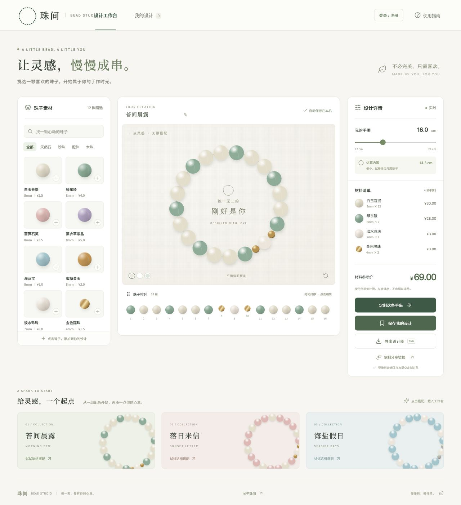
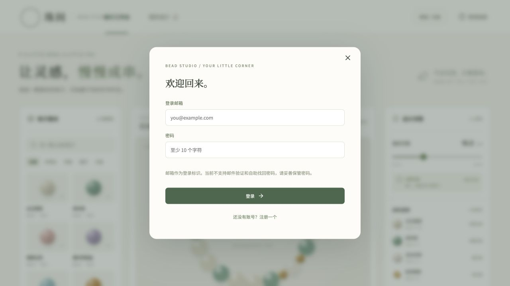
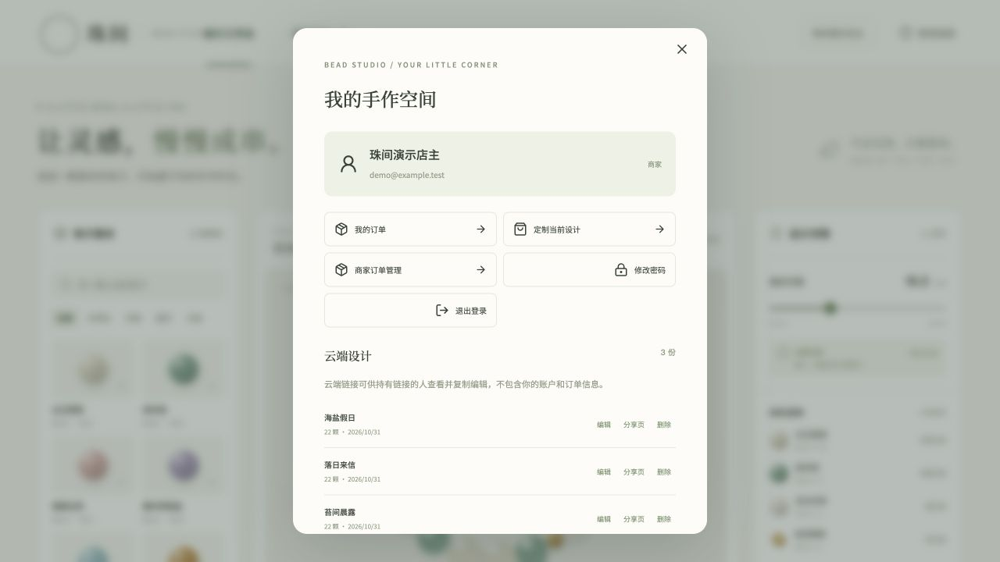
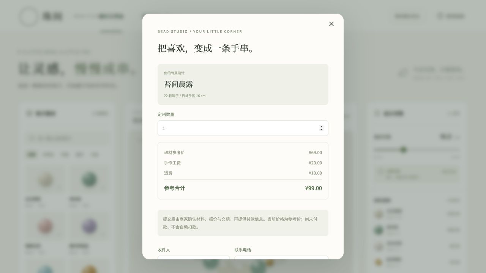
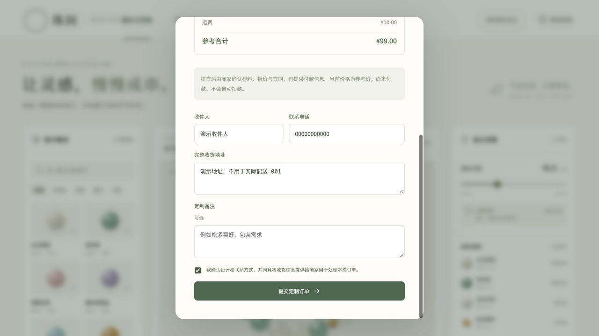
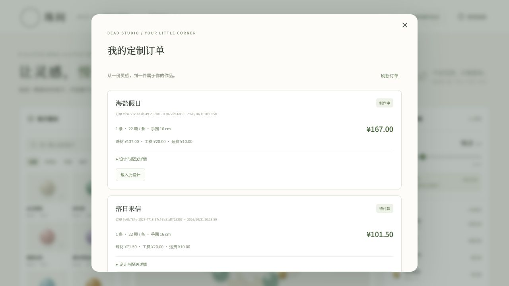
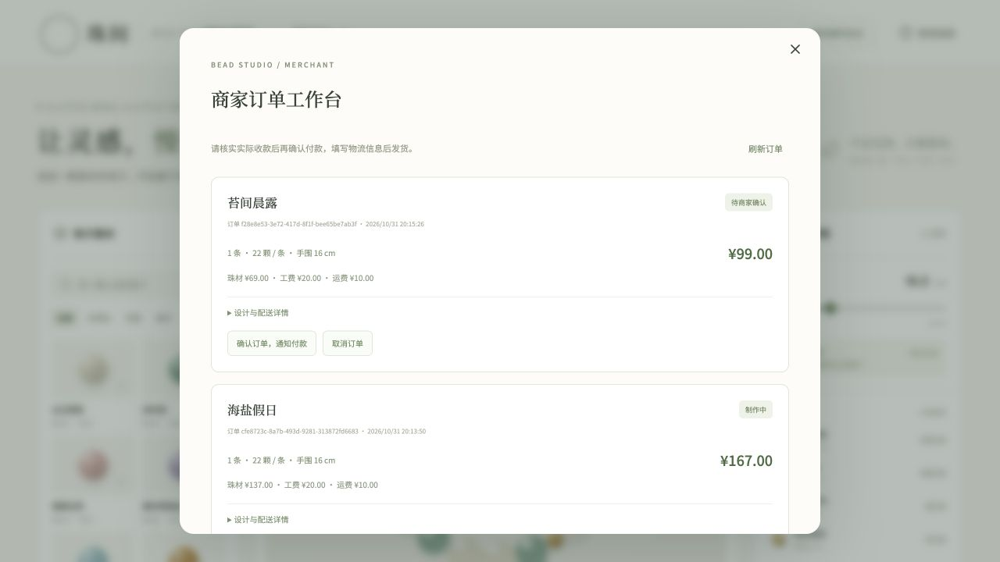
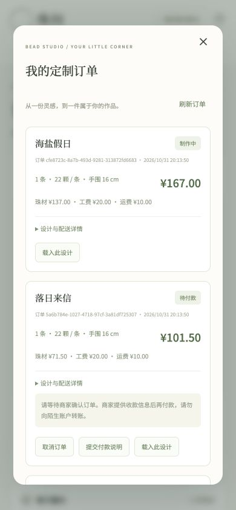

# 珠间 · Bead Studio

Preact + Signals + **H3 v2** 的手串设计与定制应用，服务端 SSR、浏览器 hydration、Cloudflare Workers + D1 持久化，亦可在 Node.js + SQLite 运行。

在线体验：[beads.bool.win](https://beads.bool.win)

## 已实现

- 响应式串珠设计器：12 款珠材、筛选搜索、拖拽/按钮排序、替换删除、内围估算和材料清单。
- 每请求独立的 Signals store，SSR 首屏直接包含内容；浏览器使用同一组件树 hydrate，之后恢复本地草稿。
- 邮箱密码注册、登录、退出、修改密码与会话撤销。密码 PBKDF2-SHA256，随机盐；HttpOnly / SameSite Cookie，会话令牌仅以摘要入库。
- 登录后的云端设计保存、列表、删除、公开设计链接 `/design/:id`；分享链接仅返回设计，不包含所有者或配送数据。
- PNG 导出、浏览器本地草稿、云端设计再次编辑。
- 服务端报价、定制数量、收货信息校验、订单幂等提交、买家订单列表/取消/付款说明/确认收货。
- 商家管理：确认订单 → 待付款 → 人工核款 → 制作 → 填写物流发货 → 完成。普通用户不能访问管理接口或他人订单。
- 390px 手机注册、结算、订单操作已验证；桌面保持三栏设计工作台。

## 功能截图

以下为当前版本的真实界面截图。账户、设计和订单均来自独立本地演示库；收件人、电话与地址是虚构数据，不代表真实交易。

### 串珠设计工作台

挑选珠材、预览配色、调整顺序与手围，实时查看材料清单和参考价格；支持导出 PNG 与分享设计。



<details>
<summary>账户与云端设计：登录、保存、分享和继续编辑</summary>

**登录入口**



**我的手作空间与云端设计**



</details>

<details>
<summary>定制下单：服务端报价、收货信息与提交订单</summary>

**珠材、工费与运费明细**



**填写配送信息并提交定制订单**



</details>

<details>
<summary>订单全流程：买家查单、商家核款、制作与发货</summary>

**买家订单：查看状态、提交付款说明、取消订单或载入原设计**



**商家订单工作台：确认订单、人工核款、开始制作与填写物流**



</details>

### 手机端

390px 视口下的设计器和订单页面；点选珠子后可用箭头排序，结算表单采用单列布局。

<p>
  
  
</p>

## 本地运行（Node.js 22.12+，含 node:sqlite）

```sh
npm ci
npm run build
ORDERS_ENABLED=true npm start
```

访问 `http://127.0.0.1:5173`。Node 本地 SQLite 自动初始化于 `.data/`（Git 忽略），默认不开启接单，需设置 `ORDERS_ENABLED=true`。

## 本地 Cloudflare Workers 环境

```sh
npm ci
npm run db:local
npm run dev
```

## Cloudflare 部署

```sh
npx wrangler login
npm run db:remote
npm run deploy
```

`wrangler.jsonc` 绑定 Worker `bead-studio`、D1 数据库和域名 `beads.bool.win`。Fork 时改为自己的 D1 database_id 和域名。修改已发布表结构时新增迁移文件，不编辑已应用迁移。

### 管理员

普通注册永远创建 customer。首次创建独立管理员：

```sh
node scripts/create-admin.mjs --remote
# 本地 Wrangler D1：不加 --remote
```

默认邮箱 `admin@beads.bool.win`，也可用 `ADMIN_EMAIL` 指定。随机密码仅保存到 `.admin-credentials.local`（权限 600、Git 忽略），不会输出到日志。已有同邮箱时脚本失败，不覆盖密码。登录后可在账户面板修改密码。Node 本地库与 Wrangler 本地库相互独立。

## API

| 接口 | 用途 |
| --- | --- |
| `GET /api/health` | H3 SSR 健康检查 |
| `GET /api/catalog`, `GET /api/shop` | 珠材、参考工费、运费与接单配置 |
| `POST /api/auth/register`, `/login`, `/logout`, `/password` | 注册、登录、退出、改密码 |
| `GET /api/me` | 当前用户 |
| `GET/POST /api/designs`, `GET/DELETE /api/designs/:id` | 个人设计与公开分享设计 |
| `POST /api/quote` | 服务端报价 |
| `GET/POST /api/orders`, `PATCH /api/orders/:id` | 买家订单 |
| `GET /api/admin/orders`, `PATCH /api/admin/orders/:id` | 商家订单管理 |

下单时客户端传递设计和数量，金额由服务端根据珠材目录重算；金额以分存储。重复 `idempotencyKey` 返回同一订单。订单变更以原状态作为数据库更新条件，避免并发覆盖。

## 支付与运营范围

按约定采用人工核款，没有接入支付宝、微信或银行卡自动扣款。付款说明不等于支付成功，只有管理员核对后才能进入制作流程。价格仍为示例参考价（工费每条 20 元、运费每单 10 元），需商家确认；`PAYMENT_INSTRUCTIONS` 可配置付款说明。没有自动短信、邮件通知、邮箱验证/自助找回密码、库存扣减、快递查询、退款或税务发票集成。投入实际运营前请配置真实珠材报价、商家联系方式及交易规则。

`ORDERS_ENABLED=false` 可暂停接单，已存在订单仍可查询与处理。不要在日志中记录密码、Cookie 或完整收货信息。

## 访问统计

正式域名 `beads.bool.win` 的 SSR 页面在 `</body>` 前加载爱站统计官方异步代码，首页和设计分享页均覆盖；本地开发和其他域名不加载，避免调试访问污染统计。统计用于页面访问分析，未额外埋点提交账号、密码、收货信息或订单表单内容。

统计报表在爱站后台查看；控制台弹窗切换不单独计为一次页面浏览。

## 自动部署 Hook

`.github/workflows/check.yml` 负责 push / PR 的构建与完整流程测试。

`.github/deploy-hook.yml.example` 为待启用的部署工作流：构建通过后由 GitHub Actions 调用 Cloudflare Deploy Hook，任何设备推送 main 均可触发。

1. 为此 Worker 连接 GitHub **仅指定** `leoyanglab/bead-studio`，配置构建命令 `npm run build`、部署命令 `npx wrangler deploy`。
2. 在 Cloudflare Builds 创建指向 `main` 的 Deploy Hook；关闭仓库自带 push 自动构建以避免重复。
3. 将完整 Hook 地址保存到仓库 Secret `CLOUDFLARE_DEPLOY_HOOK_URL`，不要提交地址到源码。
4. 将 example 移动至 `.github/workflows/deploy-hook.yml` 启用，并推送 main 实测。

当前 Hook 连接仍需完成 GitHub 的身份验证，不能把本地准备的工作流视为已启用部署。

## 验证

```sh
npm run build
npm test
npx wrangler deploy --dry-run
```

测试使用内存 SQLite 和真实 H3 请求处理器，覆盖 SSR/XSS 序列化、状态隔离、鉴权/越权、服务端金额、重复下单、订单完整流转、改密码撤销旧会话、CSRF 来源检查、非法输入及关闭接单。

MIT © 2026 leoyanglab
